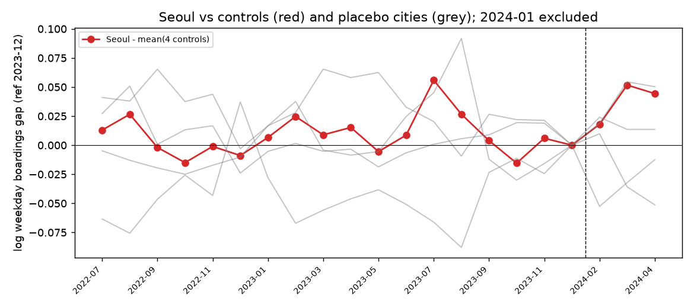

# 계획 2 결과: 비교 도시를 넷으로 늘려 다시 본 기록

작성일: 2026-10-15 / 계획서: [plan_v2.yaml](plan_v2.yaml) / 코드: `src/prepare_cities.py`, `src/estimate_cities.py`

## 한 줄 요약

**판정: 조건부.** 서울은 비교 도시 넷의 평균보다 기후동행카드 시범사업 뒤 3개월 동안 평일 승차가 약 3.0% 더 늘었습니다. 그런데 같은 계산을 다른 도시에 해 보면 서울보다 큰 값이 두 곳에서 나옵니다. 그래서 이 차이를 정책 효과로 보기는 아직 어렵습니다.

## 계획 1과 달라진 점

계획 1(서울 vs 부산, 역 단위)에서는 정책 전부터 두 도시 흐름이 달라서 결론을 보류했습니다. 이번에는 아래처럼 바꿨습니다(이유는 plan_v2.yaml과 README에 있습니다).

- 비교 도시: 부산 → 부산·대구·광주·대전
- 분석 단위: 역 → 도시(정책이 도시 단위로 정해지므로)
- 기간: 2022-07 ~ 2024-04 (K-패스가 시작된 2024-05 전에서 끊음, 2024-01은 제외)
- 대구·광주·대전 자료는 계획서와 코드를 먼저 올린 뒤에 열었습니다.

## 결과

| 항목 | 값 | 읽는 법 |
|---|---|---|
| 주 추정 (대조 4곳) | **+3.0%** | 사후 3개월(2024-02~04) 서울과 대조 평균의 격차가 사전 18개월 평균보다 3.0% 커짐 |
| 정책 전 격차 추세 | 월 +0.01%p, 95% 구간 -0.13% ~ +0.16% | 정책 전 18개월 동안 격차가 한쪽으로 기울지 않았음. 계획 1보다 나아진 부분 |
| 가짜 시작월(2023-08) | -0.6% | 정책이 없던 때로 시작을 옮기면 차이가 거의 없음 |
| 다른 도시를 '정책 도시'로 바꿔 본 값 | 대구 -5.7%, **부산 +3.6%**, 서울 +3.0%, 대전 +1.4%, 광주 +0.7% | 서울은 5곳 중 크기로 3번째. 서울만 특별히 튀지 않음 |

빨간 선이 서울과 대조 평균의 차이, 회색 선은 다른 도시를 같은 방식으로 계산한 것입니다. 점선 오른쪽이 시범사업 뒤입니다.

### 민감도

| 바꾼 조건 | 값 |
|---|---|
| 대조를 부산·광주만 (2024년 1월에 요금을 올린 대구·대전 제외) | +1.4% |
| 사전 기준을 2023-10~12로 (서울·부산 요금 인상 뒤만) | +4.2% |
| 위 두 조건을 함께 | +3.9% |
| 주말 승차 | -1.8% |
| 역 단위 (계획 1 방식에 대조 4곳 추가, 참고용) | +3.9% (역 군집 95% 구간 +3.0% ~ +4.8%, 실제 불확실성보다 좁게 나옴) |

## 판정 근거 (plan_v2.yaml 규칙)

| 조건 | 결과 |
|---|---|
| 정책 전 격차 추세 구간이 0을 포함 | 예 |
| 가짜 시작월 값이 실제 값의 절반 미만 | 예 (약 0.19배) |
| 서울이 두 순위 기준 모두 1위 | **아니오** (둘 다 3위) |
| 부산·광주만 대조로 써도 부호가 같음 | 예 (+1.4%) |

네 조건 중 하나가 맞지 않아 "조건부"입니다. 도시가 5곳뿐이라 서울이 1위였더라도 우연일 확률을 0.2보다 낮게 말할 수 없다는 점도 미리 적어 두었습니다.

## 조심해서 읽을 점

- **비교 도시의 요금 변화가 결과를 움직입니다.** 대구(2024-01-13)와 대전(2024-01-01)은 시범사업과 거의 같은 때 요금을 올렸습니다. 대구는 다른 도시보다 승차가 5.7% 줄어 대조 평균을 끌어내렸고, 이 두 도시를 빼면 서울의 값이 3.0%에서 1.4%로 줄어듭니다.
- **부산도 비슷하게 늘었습니다.** 부산은 서울과 같은 시기(2023-10)에 요금을 올렸고, 2023-08부터 동백패스가 있었습니다. 부산의 +3.6%를 보면 서울의 +3.0%가 서울만의 일이라고 보기 어렵습니다.
- **사후 기간이 3개월로 짧습니다.** K-패스 전국 시행 전에서 끊어서 생긴 한계입니다.
- **주말은 반대 방향(-1.8%)입니다.** 정액권이라 주말 이용이 더 늘 거라는 생각과 다르게 나왔고, 이유는 아직 모릅니다.
- 서울교통공사 노선 중 서울 밖에 있는 역(7호선 부천 구간 등)도 일부 포함되어 있습니다.
- 대구 2023년 파일에는 12월 자료가 두 번 들어 있었습니다(합계 차이 약 0.007%). 뒤에 나온 자료를 썼습니다. 대구 2024년 파일에는 2월 29일이 없습니다.

## 계획 1과 비교해서 배운 점

- 비교 도시를 늘리고 도시 단위로 보니 정책 전 흐름이 나란해졌습니다. 계획 1에서 보였던 추세 차이는 부산 한 곳과만 비교한 점, 그리고 역 단위로 계산해 불확실성이 작게 잡힌 점에서 왔을 수 있습니다. 둘 중 어느 쪽이 더 컸는지는 아직 나눠 보지 않았습니다.
- 대신 "다른 도시도 이 정도는 움직인다"는 기준이 생겨서, 3% 정도의 차이는 도시들 사이의 보통 움직임과 구분되지 않는다는 것을 알게 됐습니다.
- 같은 시기 다른 도시의 요금 변화가 대조군을 흔든다는 점도 직접 확인했습니다.

## 다음에 해 볼 것

- 인천, 경기 등 수도권 다른 노선을 넣을 수 있는지 (다만 같은 요금 체계라 대조로 쓰기 어려운 점도 함께 확인)
- 본사업(2024-07) 이후까지 늘리되 K-패스를 함께 고려하는 방법
- 시간대별(출퇴근 vs 낮 시간) 차이

이 분석은 공부 목적으로 공개 자료를 정리한 것이며 공식 평가가 아닙니다.

## 데이터 출처 (공공데이터포털, 이용허락범위 제한 없음)

- 서울교통공사 15099330, 부산교통공사 3057229 (계획 1과 같음)
- 대구교통공사_역별일별시간별승하차인원현황 (data.go.kr/data/15002503): 과거 파일 20221231, 20231231, 20240430
- 광주교통공사_역일시간대별 승하차량 (data.go.kr/data/15060048): 과거 파일 20221231, 20231231, 20240430
- 대전교통공사_시간대별 승하차인원 (data.go.kr/data/15060591): 과거 파일 20221231, 20231231, 20241231

## 요금 변화 출처

- 기후동행카드 시범사업 1/27 시작: https://news.seoul.go.kr/traffic/archives/513130
- 수도권 지하철 요금 인상 2023-10-07: https://biz.heraldcorp.com/article/3225780
- 부산 도시철도 요금 인상 2023-10-06: https://www.busan.go.kr/news/snsbusan01/view?dataNo=68726
- 부산 동백패스 2023-08-01: https://www.busan.go.kr/depart/dongbaegpass001
- 대전 도시철도 요금 인상 2024-01-01: 대전시 소식 (daejeon.go.kr, 2023-11-23 게시)
- 대구 도시철도 요금 인상 2024-01-13: 대구교통공사 안내를 인용한 2024-01-10 보도
- K-패스 2024-05-01 시행: https://www.korea.kr/news/policyNewsView.do?newsId=148928697
